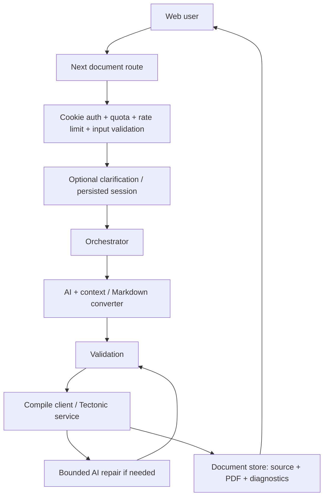

# Kiến trúc hiện có — source snapshot 2026-11-16

Baseline `main@4c3da4646`; working tree ban đầu sạch. Đọc README, rules, architecture/codebase docs, routes, storage/auth, schema và Docker. Không kiểm tra cấu hình production hoặc database đang chạy.

## Các khối

| Khối | Hiện có | Nguồn |
|---|---|---|
| UI + BFF | Next.js 16.2.9, React 19.2.4; landing `/`, workspace `/app`, editor `/documents/[id]`; React Query/Zustand, Tailwind 4 | `package.json`, `app/`, `components/` |
| Document API | CRUD, tạo tài liệu, chat-edit, cập nhật source/recompile, clarification/resume; SSE progress | `app/api/documents/route.ts`, `app/api/documents/[id]/route.ts`, `.../chat/route.ts`, `.../clarify/[jobId]/resume/route.ts` |
| Domain/orchestrator | `runDocument`, `runDocumentFromMarkdown`, `runProject`, `runEdit`; dependency injection qua `OrchestratorDeps` | `lib/orchestrator/document.ts:33,245,353,419,483`, `deps.ts:21` |
| AI/context | Provider factory, prompt/context pipeline; truncation retry tách khỏi validate/compile/repair; retrieval tùy cấu hình | `lib/ai/`, `lib/context-engineering/`, `lib/rag/`, `lib/orchestrator/deps.ts` |
| Templates/validation | 11 template, package allowlist, structure checks; article/report và class cụ thể như beamer/exam/letter | `lib/types/document.ts`, `lib/templates/registry.ts`, `lib/validation/` |
| Import | PDF/DOCX/text/ảnh OCR; Markdown converter; multi-file source model | `lib/extract/`, `lib/markdown/`, `lib/store/project-document.ts` |
| Storage | Facade chọn JSON file hoặc Supabase; document chứa source, base64 PDF, logs, chat, multi-file | `lib/store/documentStore.ts`, `file-document-store.ts`, `supabase-document-store.ts` |
| Auth/data boundary | Supabase cookie session; route lấy user; Postgres RLS theo owner; quota daily generation dùng RPC | `lib/auth/`, `utils/supabase/`, `supabase/migrations/0001_documents.sql`, `0004_accounts-workspaces-and-generation-quota.sql` |
| Compiler | Express + Tectonic; client timeout; nhận single/multi-file, trả PDF/lỗi | `compile-service/`, `lib/compile/client.ts`, `app/api/compile/route.ts` |
| Deploy | Caddy → Next; compiler nội bộ, host binding loopback; container hạn chế CPU/RAM/PID, read-only, non-root | `docker-compose.yml`, `Caddyfile`, `compile-service/Dockerfile` |
| Verification tooling | Vitest; compiler node:test; Promptfoo đánh giá prompt riêng đường production | `package.json`, `compile-service/package.json`, `lib/prompt-eval/` |

## Luồng chính

Compile-only đã có ở `/api/compile`; PATCH document hỗ trợ source/recompile. Đây là nền cho MVP MCP nhưng chưa có một application service tổng hợp nhận source → compile → persist có identity độc lập transport.

## Khoảng trống ảnh hưởng trực tiếp MCP

1. **Cookie coupling:** current-user, Supabase document store, clarification store và generation quota gọi `cookies()`; chưa nhận principal/client từ MCP bearer. Tách dependency này trước.
2. **Auth không đồng nhất:** `/api/compile` chưa có auth/rate-limit trong handler; `/api/documents/[id]/approve-plan` truyền owner undefined khi chưa login. Không sao chép quyền của các route này sang MCP. Nên sửa compile ingress trong phạm vi triển khai để tránh đường public bypass quota; approval-plan giữ ngoài MCP và ghi issue riêng.
3. **Chưa có durable execution queue:** SSE giữ request cho generation/edit; clarification session không phải generic job. Timeout compile client không phải cancel end-to-end.
4. **Quota/rate limit:** generation quota chỉ active với Supabase, hiện consume trước validate input ở create route; limiter theo IP, in-memory. Compile MCP cần quota theo user/client và idempotency riêng, không tái dùng quota AI một cách ngầm định.
5. **PDF delivery:** stored base64, web tạo blob URL trong `components/PdfPreview.tsx`; blob URL browser không dùng cho remote host. Cần artifact endpoint/short-lived download grant và trang mở tài liệu.
6. **Concurrent edits:** update/append dùng read-modify-write, chưa thấy revision/CAS contract. MCP và web cùng sửa cần revision conflict protection trước khi mở tool cập nhật.
7. **Workspace mới là nền schema:** migration 0004 thêm workspaces/workspace_id nhưng StoredDocument và Supabase mapper chưa dùng workspace_id; isolation hiện tại là owner user, không tuyên bố đã có team tenancy.
8. **State machine chưa đồng bộ persistence:** types có status/planContent, handlers có analyze/plan/generate; Supabase row mapper/patch và migrations documents chưa lưu hai field này. Không coi approval-plan là nền job đã hoàn thiện.
9. **Chưa thấy MCP SDK/endpoint/plugin package** trong dependency và các đường được khảo sát; cần thêm mới transport/contract.

## Tài liệu cần cập nhật sau triển khai

README còn xếp Markdown/RAG/OCR/multi-file vào roadmap dù source đã có các phần này. `docs/codebase-summary.md` còn ghi 4 templates; types/registry hiện có 11. `docs/system-architecture.md` chưa bao quát clarification và các nhánh mới. `docs/deployment-guide.md` không tồn tại tại đường dẫn AGENTS nhắc đến: lấy Docker/Caddy làm bằng chứng deployment hiện có, bổ sung guide khi triển khai.

## Giới hạn bằng chứng

GitNexus CLI help hoạt động nhưng query lỗi load `@ladybugdb/core`; meta index tại `d2b63e6...`, khác HEAD khảo sát. Không suy ra blast radius từ index stale. Không sửa symbol ở lượt này. Chưa chạy app/test/compiler, không khẳng định mọi nhánh đã chạy thành công hoặc migrations đã áp dụng trên môi trường thật.
