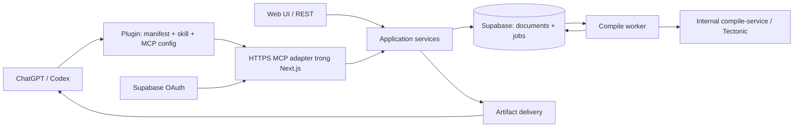

# Plan: MCP + plugin cho ChatGPT/Codex

Ngày: 2026-11-16. Baseline khảo sát ban đầu: `main@4c3da4646`. Cập nhật 2026-11-17: local MCP compile, OAuth và realtime source editing đã triển khai; private plugin `LaTeX AI Generator` đã lưu trong ChatGPT. Plugin package hiện vẫn trỏ localhost nên OAuth/full-flow ChatGPT cloud chưa nghiệm thu.

## Mục tiêu đã chốt

ChatGPT viết LaTeX theo contract/template của web; project nhận source qua MCP, compile bằng Tectonic, lưu tài liệu và trả PDF. User xác thực bằng đúng Supabase account web, có thể chọn/sửa tài liệu đang tồn tại và nhìn revision đổi trong web editor realtime. GPT là nơi sinh/sửa source; không gọi AI của project trong MCP flow.

## Tài liệu

- [Kiến trúc hiện có và khoảng trống](architecture-current.md)
- [Phase 1: contract, identity và shared services](phase-01-contract-and-identity.md)
- [Phase 2: compile jobs, artifacts và MCP](phase-02-compile-and-mcp.md)
- [Phase 3: plugin và nghiệm thu hai host](phase-03-plugin-and-acceptance.md)
- [Nguồn chính thức và giới hạn xác minh](research.md)
- [Phase 4: ChatGPT account linking, edit tài liệu và output theo format web](phase-04-chatgpt-account-linking-and-authoring.md)

## Kiến trúc đề xuất

MCP adapter dùng Node runtime, cùng codebase và deployment Next.js trước; worker là process/container riêng. Không cần thêm microservice HTTP độc lập chỉ để bọc tools. Không gọi vòng qua REST bằng cookie giả. MCP transport dùng Streamable HTTP, khác SSE nghiệp vụ đang có.

## Thứ tự và acceptance ledger

| ID | Kết quả cần đạt | Phase / phụ thuộc | Bằng chứng nghiệm thu | Hiện tại |
|---|---|---|---|---|
| R1 | Tổng hợp kiến trúc theo code | Khảo sát | Source và migration trong architecture-current.md | Hoàn thành |
| R2 | Compile/lưu/PDF qua MCP | 1–2 | Local OAuth, Tectonic, job, artifact, retry | Đã triển khai/kiểm tra local |
| R3 | Identity OAuth + cô lập user | 1, 4/P1 | Một consent bundle; đúng Supabase user; revoke chặn MCP/RPC/RLS; negative cross-user | Consent UI + active-consent DB boundary local verified; ChatGPT cloud và full cross-user matrix pending |
| R4 | Realtime source edit | 4/P2 | CAS, WS, draft conflict, editor cùng document | CAS project patch + binary preservation đã qua SQL local; editor realtime project E2E pending |
| R5 | Web-compatible generation | 4/P3 | Template contract, metadata, validation, Tectonic | Spec tool + source validator đã triển khai; 7 spec tests, 3 MCP tests, 11 validator tests pass; Tectonic/web reopen chưa xác minh |
| R6 | Private plugin full flow trên ChatGPT | 3, 4/P0–P4 | Login → chọn/sửa record → realtime → compile web | Plugin đã lưu; MCP cloud connection chưa nghiệm thu |

Root giữ scope/acceptance và tự kiểm tra thay đổi local. DeepSeek wrapper được thử cho validator packet và project patch packet; hai lượt project patch bị wrapper `output_limit`, nên implementation project update được root viết và xác minh. Wrapper báo permission enforcement `unverified`.

## Ngoài MVP

- AI generation/edit, RAG, OCR/import file đính kèm từ host, approval-plan và job clarification.
- MCP App UI nhúng PDF; public marketplace submission; phát hành production.
- Team workspaces, realtime collaboration, generic filesystem access và tool xóa tài liệu.
- STDIO adapter riêng: chỉ bổ sung nếu có nhu cầu local/offline; remote HTTPS phục vụ mục tiêu hai host.

## Quyết định còn mở trước triển khai tương ứng

- Supabase project và domain staging; quyền bật OAuth/consent; chính sách đăng ký OAuth client.
- Chính sách lưu PDF/retention và hạn mức compile; chưa gán số quota hoặc SLA khi chưa đo.
- Giai đoạn phát hành đầu là private plugin; public listing chỉ làm khi có yêu cầu riêng.

Kiểm tra local ngày 2026-11-17: Next build và TypeScript pass. Lint phạm vi MCP pass. Compiler pass 13/13, auth/consent pass 22/22. Full suite pass 431/435, baseline cùng 4 lỗi ở CV và clarification. PostgreSQL 17 áp dụng migrations 0001–0006. Kiểm tra SQL xác nhận retry, cô lập owner, giữ nguyên byte PDF Tectonic, từ chối dùng lại grant, giới hạn direct write của OAuth và giữ quyền cập nhật của web session.

Đã chạy full flow qua Supabase Auth local, Next.js, MCP SDK, worker và Tectonic trong Docker. OAuth authorization code + PKCE qua consent của app, discovery đủ 7 tools, compile/lưu/tải PDF hợp lệ và source đọc lại trùng khớp. TeX lỗi trả chẩn đoán và không có artifact. Sau khi thu hồi consent, token đã cấp trả HTTP 401. Lần chạy này bổ sung migration 0007 để kiểm tra grant bằng RPC theo user, vì GoTrue từ chối OAuth bearer tại endpoint quản lý grants.

Chưa nghiệm thu plugin trong ChatGPT/Codex. GitNexus impact còn lỗi native và index cũ, nên phần sửa endpoint compile cũ chưa thực hiện. Bản local chỉ dùng TeX đáng tin cậy cho đến khi xác minh cách ly filesystem theo từng job. Xem [hướng dẫn local](../../docs/deployment-guide.md).

## Mở rộng đã triển khai local: chỉnh cùng tài liệu trong editor web

- [x] Đăng ký tool `update_document_source`: dùng lại documentId, gửi bản nguồn mới và đúng updatedAt vừa đọc.
- [x] Lưu source theo phiên bản trong PostgreSQL, phát thông báo revision theo owner qua Supabase Realtime.
- [x] Editor đồng bộ bản sạch qua WebSocket và giữ draft khi có xung đột. Lưu từ web kiểm tra phiên bản với Supabase.
- [x] Nghiệm thu OAuth MCP → WebSocket → editor trên local. Kiểm chứng cùng documentId, cập nhật không refresh, từ chối phiên bản cũ và giữ bản nháp trong ca xung đột. Việc cài plugin trên host thật theo phase 3.

## Yêu cầu tiếp theo

Kết nối OAuth đúng tài khoản, active-consent enforcement và nghiệm thu ChatGPT cloud còn theo [Phase 4](phase-04-chatgpt-account-linking-and-authoring.md). User chọn một consent bundle; Supabase không hỗ trợ custom OAuth scopes nên plugin chỉ dùng scopes chuẩn và mô tả quyền đầy đủ trong consent UI. P2 project patch và P3 format contract có implementation local; project editor realtime E2E và cloud/full-flow chưa nghiệm thu.
